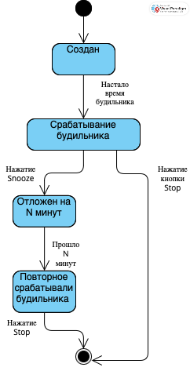

---

## Задание 1. «Будильник» — анализ требований и тест-дизайн

### 1. Пробелы и противоречия (Вопросы к продукт-менеджеру)
1. **Просроченное время / прошедшая дата:** Что происходит, если пользователь пытается создать одноразовый будильник на дату и время, которые уже прошли в текущие сутки (например, текущее время 15:00, а будильник ставят на 14:00)? Блокируется ли создание или будильник сработает на следующий день?
2. **Поведение при выключении повторяющегося будильника:** Если пользователь вручную выключает переключатель для повторяющегося будильника (Требование 5), сбрасывается ли расписание, или оно просто замораживается до момента включения? Пропустит ли будильник пропущенные дни в выключенном состоянии?
3. **Конфликт часовых поясов / сдвиг времени:** Как система ведет себя, если во время активного будильника пользователь меняет часовой пояс вручную или телефон автоматически обновляет его при перелете? Пересчитывается ли время срабатывания будильника?
4. **Конфигурация «долгий сон»:** Каков интервал времени между повторениями `snooze` в зоне «долгого сна» (фиксированный или настраиваемый)? Что происходит ровно после **5-го** срабатывания `snooze` — будильник отключается навсегда, переходит в непрерывный громкий режим или требует обязательного ввода пин-кода/решения примера?
5. **Ограничение на количество будильников:** Существует ли максимальное количество будильников, которое пользователь может одновременно создать или держать активными в списке? Есть ли требования к UI при прокрутке длинного списка?

---

### 2. Приоритизированный чек-лист (Smoke-критерии)
1. Создание одноразового будильника с валидными временем и датой; проверка его появления в списке.
2. Создание повторяющегося будильника (выбор нескольких дней недели); проверка статуса.
3. Переключение тумблера включения/выключения (`ON/OFF`) для существующего будильника в списке; проверка сохранения состояния.
4. Срабатывание будильника в заданное время; проверка появления уведомления с кнопками **Snooze** и **Stop**.
5. Нажатие кнопки **Stop** при срабатывании; проверка прекращения звука/вибрации и закрытия уведомления.
6. Нажатие кнопки **Snooze** при срабатывании; проверка повторного срабатывания будильника через заданный интервал N минут.
7. Проверка автоматического отключения одноразового будильника (`OFF` статус) после его срабатывания (Требование 4).
8. Удаление будильника из списка; проверка его полного исчезновения из интерфейса и отмены запланированной системной задачи (системного будильника).

---

### 3. Применение техник тест-дизайна
Для тестирования функционала были выбраны три техники тест-дизайна:

#### Техника 1. Классы эквивалентности
* **Объект тестирования:** Поле ввода времени будильника (формат 24 часа, ЧЧ:ММ).
* **Разделение на классы:**
  * *Валидный класс:* Часы от `00` до `23`, минуты от `00` до `59` (например, `08:30`, `23:59`).
  * *Невалидный класс 1 (Часы):* Значения вне диапазона (`24:00`, `-01:15`, буквы вместо цифр).
  * *Невалидный класс 2 (Минуты):* Значения вне диапазона (`12:60`, `12:-5`).
  * *Невалидный класс 3 (Формат):* Некорректный разделитель или длина (`12-30`, `1230`, `1:5`).
* **Тестовый сценарий:** Попытка ввода значений из каждого невалидного класса для проверки блокировки сохранения и вывода ошибки валидации, а также успешный ввод из валидного класса.

#### Техника 2. Анализ граничных значений
* **Объект тестирования:** Количество повторов функции откладывания (`snooze`) в зоне «долгого сна» (лимит — до 5 раз).
* **Граничные значения:** 
  * Нижняя граница: `0` (отключение функции snooze), `1` (первое откладывание).
  * Внутренние значения: `3` (середина).
  * Верхняя граница: `5` (максимально разрешенное количество повторов), `6` (выход за верхнюю границу).
* **Тестовый сценарий:** Проверка поведения системы ровно на 5-м срабатывании snooze (разрешено) и попытка уйти на 6-й snooze (должно быть заблокировано: например, кнопка snooze неактивна или будильник переходит в принудительный режим Stop).

#### Техника 3. Переход состояний
* **Объект тестирования:** Жизненный цикл одноразового будильника.
* **Состояния:** `Создан (Активен)`, `Выключен вручную`, `Звонит`, `Отложен (Snooze)`, `Завершен (Авто-отключен)`.
* **Тестовый сценарий:** Проверка переходов состояний:


---

### 4. Бонус вопрос: Рискованный сценарий (Edge Case)
> **Рискованный сценарий:** Пользователь устанавливает повторяющийся будильник на каждый день на **02:30** в ночь осеннего перехода на зимнее время (когда стрелки часов переводятся назад с 03:00 на 02:00, из-за чего интервал времени с 02:00 до 03:00 **происходит дважды**).
> 
> **Почему это важно:** В момент первого прохождения интервала 02:30 будильник срабатывает штатно. Но когда часы переводятся назад на 02:00, время 02:30 наступает **второй раз** за те же сутки. Если системный планировщик задач ОС привязан к абсолютному времени или не учитывает повторное прохождение часа, будильник может сработать второй раз подряд с разницей в час, либо зависнуть в планировщике, пропустив реальное срабатывание на следующий день. Требуется четкое требование от разработчиков: срабатывает ли будильник дважды в день «двойного» часа или пропускает второе появление времени.

---

## Задание 2. «Создание заказа» — проверка API и обработки ошибок

### 1. Анализ требований и вопросы к аналитику/разработчику
1. **Поведение при дубликатах товаров:** Что должна сделать система, если в массиве `items` переданы одинаковые `product_id` (например, товар 101 указан в двух разных объектах списка)? Должна ли система суммировать `quantity` или вернуть *HTTP 400 Bad Request*?
2. **Типизация и форматы:** Допускается ли передача `quantity` в виде строки (например, `"2"`) или дробного числа (например, `2.5`), учитывая Требование 3 («положительное целое число»)? Вернет ли сервер в таком случае *400 Bad Request* или выполнит неявное приведение типов?
3. **Таймаут внешнего сервиса остатков:** В Требовании 8 описан возврат *HTTP 503* при временной недоступности сервиса остатков. Какой именно порог ожидания задан на стороне сервиса заказов при обращении к сервису остатков (например, 2 секунды)?

---

### 2. Чек-лист тестирования создания заказа
1. Позитивный: Создание заказа с валидным `user_id` и одним товаром с корректным `quantity` -> *HTTP 201 Created*.
2. Позитивный: Создание заказа с несколькими уникальными товарами в массиве `items` -> *HTTP 201 Created*.
3. Негативный: Отсутствие обязательного поля `user_id` в теле запроса -> *HTTP 400 Bad Request* (Требование 1, 5).
4. Негативный: Передача пустого массива `items: []` -> *HTTP 400 Bad Request* (Требование 1, 5).
5. Негативный: Передача нулевого количества товара `quantity: 0` -> *HTTP 400 Bad Request* (Требование 3, 5).
6. Негативный: Передача отрицательного количества товара `quantity: -3` -> *HTTP 400 Bad Request* (Требование 3, 5).
7. Негативный: Передача несуществующего `product_id` (например, `99999`) -> *HTTP 404 Not Found* (Требование 6).
8. Негативный: Запрос количества товара, превышающего текущий остаток на складе -> *HTTP 409 Conflict* (Требование 7).
9. Негативный: Проверка обработки сбоя, когда сервис остатков возвращает ошибку таймаута / недоступен -> *HTTP 503 Service Unavailable* (Требование 8).
10. Негативный: Отсутствие или невалидный заголовок `Content-Type: application/json` -> *HTTP 400 Bad Request*.

---

### 3. Подробные тест-кейсы API

#### Тест-кейс 1: Успешное создание заказа (Позитивный)
* **Предусловия:** Пользователь с `id = 15` существует в БД. Товар с `product_id = 101` существует, на складе имеется в наличии >= 2 штук.
* **HTTP-метод и Endpoint:** `POST /orders`
* **Тело запроса (JSON):**
  ```json
  {
    "user_id": 15,
    "items": [
      {
        "product_id": 101,
        "quantity": 2
      }
    ]
  }
  ```
* **Ожидаемый HTTP-статус:** `201 Created`
* **Ожидаемый результат:** В ответе возвращается JSON-объект, содержащий уникальный идентификатор заказа (`id`) и статус `"status": "created"`. В БД создана запись заказа, остаток товара 101 на складе уменьшен на 2.

#### Тест-кейс 2: Некорректные данные (Негативный — нулевое количество)
* **Предусловия:** Пользователь `15` и товар `101` существуют.
* **HTTP-метод и Endpoint:** `POST /orders`
* **Тело запроса (JSON):**
  ```json
  {
    "user_id": 15,
    "items": [
      {
        "product_id": 101,
        "quantity": 0
      }
    ]
  }
  ```
* **Ожидаемый HTTP-статус:** `400 Bad Request`
* **Ожидаемый результат:** Заказ не создан, склад не изменен. В теле ответа содержится описание ошибки валидации поля `quantity`.

#### Тест-кейс 3: Ошибка взаимодействия с зависимым сервисом (Негативный — сервис остатков недоступен)
* **Предусловия:** Сервис проверки остатков временно смоделирован как недоступный (выключен / возвращает сетевой сбой / 500 ошибку).
* **HTTP-метод и Endpoint:** `POST /orders`
* **Тело запроса (JSON):**
  ```json
  {
    "user_id": 15,
    "items": [
      {
        "product_id": 101,
        "quantity": 1
      }
    ]
  }
  ```
* **Ожидаемый HTTP-статус:** `503 Service Unavailable`
* **Ожидаемый результат:** Заказ не создан. Клиент получает корректный ответ о недоступности сервиса проверки остатков.

---

### 4. Почему недостаточно проверять только HTTP-статус?
Проверка одного лишь HTTP-статуса (например, `201 Created`) не гарантирует корректность работы бизнес-логики. Дополнительно необходимо проверить:
1. **Состояние базы данных (БД):** Действительно ли в таблице `orders` появилась запись с правильным `user_id`, а в таблице позиций заказа (`order_items`) зафиксированы верные `product_id` и `quantity`.
2. **Интеграционные эффекты (Склад):** Списалось ли со склада ровно то количество товара, которое было заказано (нет ли утечки остатков или двойного списания).
3. **Тело ответа (Payload):** Соответствует ли структура JSON-ответа спецификации (наличие обязательных полей `id`, `status: "created"`, правильный формат данных).

---

### 5. Бонус вопрос: Обрыв соединения и повторный запрос (Идемпотентность)
* **Какие проблемы могут возникнуть:** 
  1. Первый запрос успешно дошел до сервера, сервер создал заказ в БД и списал товар, но ответ (`201 Created`) не дошел до клиента из-за обрыва связи.
  2. Клиент, не получив ответа, выполняет повторную отправку (`retry`) того же самого запроса.
  3. Если API не идемпотентно, система создаст **второй идентичный заказ** и повторно спишет товар со склада, что приведет к дублированию заказа и двойному списанию средств/остатков.
* **Вопросы команде:** 
  1. Реализована ли поддержка идемпотентности для эндпоинта `POST /orders`?
  2. Как бэкенд обрабатывает дублирующие запросы в случае сетевых таймаутов?
* **Что предложить проверить:** 
  1. Проверить поведение системы при отправке двух одинаковых POST-запросов подряд: второй запрос должен либо вернуть уже созданный заказ (без создания дубликата), либо отклонить его с соответствующим кодом (например, `409 Conflict`).
  2. Убедиться, что при повторной отправке остатки на складе списываются ровно один раз.

---

## Задание 3. SQL — базовые запросы

### 1. Вывести список пользователей из Москвы
```sql
SELECT * 
FROM users 
WHERE city = 'Москва';
```

### 2. Вывести общую сумму оплаченных заказов по каждому пользователю (включая пользователей без заказов)
```sql
SELECT u.id, u.name, COALESCE(SUM(o.total), 0) AS total_completed_amount
FROM users u
LEFT JOIN orders o ON u.id = o.user_id AND o.status = 'completed'
GROUP BY u.id, u.name;
```

### 3. Вывести пользователей, у которых есть хотя бы один заказ со статусом `returned`
```sql
SELECT 
    u.id, 
    u.name, 
    u.city, 
    u.created_at
FROM users u
JOIN orders o ON u.id = o.user_id
WHERE o.status = 'returned' 
GROUP BY u.id, u.name, u.city, u.created_at
HAVING COUNT(o.id) >= 1; 
```

### 4. Вывести топ-3 пользователей по сумме оплаченных заказов
```sql
SELECT u.id, u.name, SUM(o.total) AS total_completed_amount
FROM users u
JOIN orders o ON u.id = o.user_id
WHERE o.status = 'completed'
GROUP BY u.id, u.name
ORDER BY total_completed_amount DESC
LIMIT 3;
```

### 5. Вывести пользователей, не делавших ни одного заказа
```sql
SELECT 
    u.id, 
    u.name, 
    u.city, 
    u.created_at
FROM users u
LEFT JOIN orders o ON u.id = o.user_id
GROUP BY u.id, u.name, u.city, u.created_at
HAVING COUNT(o.id) = 0;
```

### 6. (Дополнительно) Вывести для каждого города среднюю сумму одного заказа по оплаченным заказам
```sql
SELECT u.city, AVG(o.total) AS avg_completed_order_amount
FROM users u
JOIN orders o ON u.id = o.user_id
WHERE o.status = 'completed'
GROUP BY u.city;
```